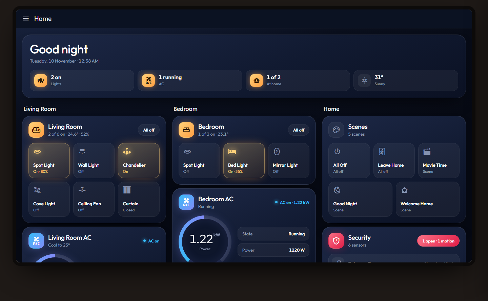
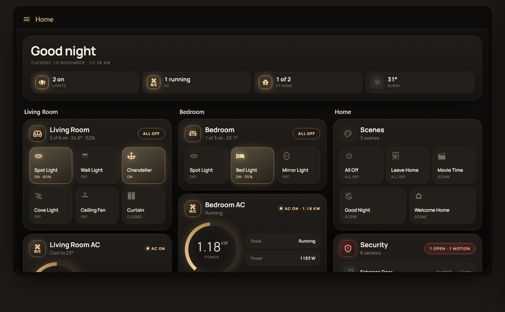
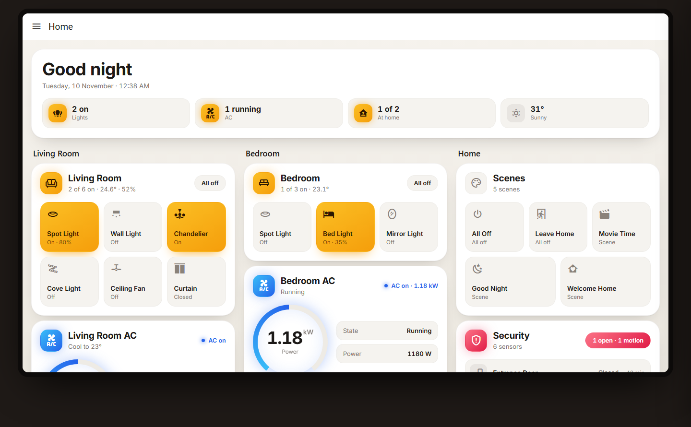
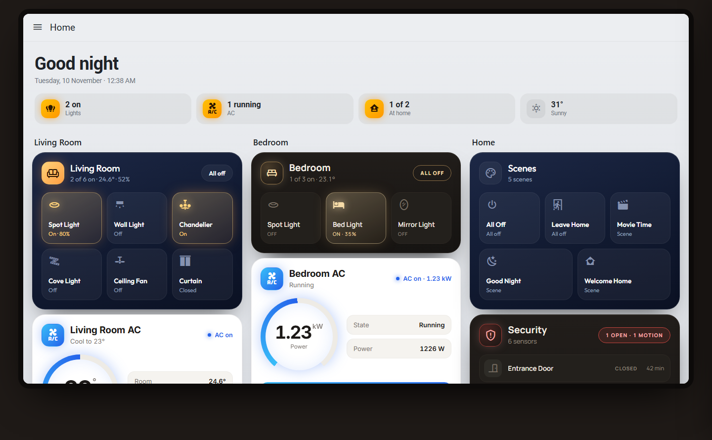
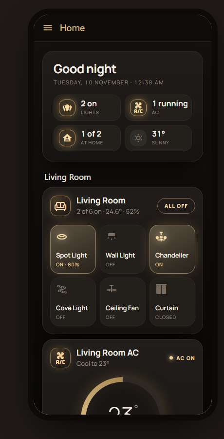
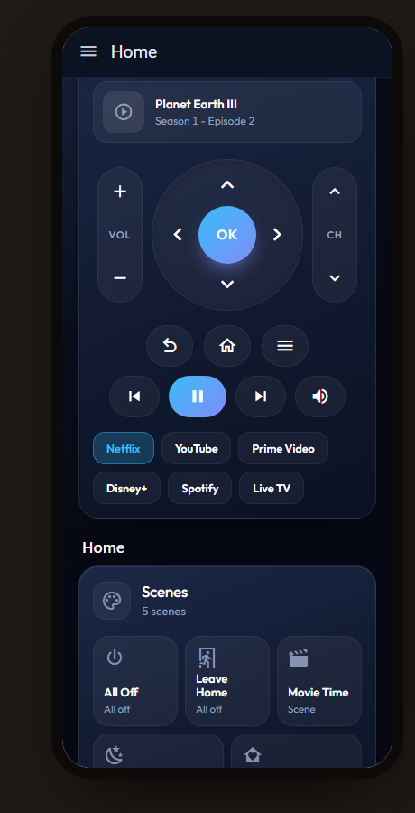

# Engineer Ismail Cards

Premium dashboard cards for Home Assistant: **Page Style**, **Room**, **AC**, **Scenes**, **Security**, **Energy** and **TV Remote**.



## Features

- **One-click page look.** Add the Page Style card, pick a look, and the background, top bar, sidebar, section titles and all cards change together.
- Looks: **Midnight Glow**, **Luxe Gold**, **Amber Light**, plus **Mix** (light or dark grey page for cards in different colours).
- Set up everything in the visual editor. No YAML needed.
- Change the name, icon, background, icon colour, text colour and "on" colour of every card.
- Round dial for AC and energy, soft glow when a device is on.
- Tiles always fill the row, whatever the number of devices.
- Made for the **Sections** dashboard: drag, drop and resize.
- Fits phone, tablet, PC and TV automatically.

| Luxe Gold | Amber Light |
|---|---|
|  |  |

| Mix (cards in different looks) | Phone | TV Remote |
|---|---|---|
|  |  |  |

## Installation

### HACS (recommended)

1. Open **HACS** in Home Assistant.
2. Click the three dots (top right) and choose **Custom repositories**.
3. Paste the URL of this repository, select type **Dashboard** and click **Add**.
4. Search for **Engineer Ismail Cards** and click **Download**.
5. Refresh your browser (Ctrl + F5 or pull down on the mobile app).

### Manual

1. Download `engineer-ismail-cards.js` from the latest release (or from the `dist` folder).
2. Copy it to `/config/www/engineer-ismail-cards.js`.
3. Go to **Settings > Dashboards**, click the three dots, then **Resources > Add resource**.
4. URL: `/local/engineer-ismail-cards.js`, type: **JavaScript module**.
5. Refresh your browser.

## Quick start

### Option A: ready-made dashboard (fastest)

1. **Settings > Dashboards > Add dashboard > New dashboard from scratch.**
2. Open it, click the pencil, then the three dots > **Raw configuration editor**.
3. Delete everything, paste [`templates/dashboard.yaml`](templates/dashboard.yaml), click **Save**.
4. Open each card and pick your own devices.

### Option B: build your own

1. Open a dashboard (a **Sections** view is best) and click the pencil.
2. Click **Add card**, search for **EI** and add **EI Page Style** first. Pick a look.
3. Add the other EI cards and choose your devices.
4. Drag cards where you want them. The "New section" titles can be renamed or deleted.

## Cards

| Card | What it does |
|---|---|
| `ei-page-card` | Sets the look of the whole dashboard in one click. Optional welcome banner with greeting, time, lights on, AC running, people at home and weather. |
| `ei-room-card` | A room with its lights and switches. Tap to toggle, hold for details, one tap for all on / all off. Shows temperature and humidity. |
| `ei-ac-card` | AC with a round dial, +/-, modes and fan speed. Works with a climate entity, or a switch with a power sensor. |
| `ei-scenes-card` | Scene and script buttons. An "all off" scene can also switch off a list of devices. |
| `ei-security-card` | Doors, windows, motion sensors and locks, with status and time since last change. |
| `ei-energy-card` | Live power dial with voltage, current and energy. |
| `ei-remote-card` | TV remote: arrows, OK, back, home, menu, volume, channels, play/pause and app buttons. |

## Page looks

| Look | Page | Cards |
|---|---|---|
| `midnight` | Dark blue | All EI cards turn Midnight Glow |
| `gold` | Black | All EI cards turn Luxe Gold |
| `amber` | Warm white | All EI cards turn Amber Light |
| `mix` | Light grey | Each card keeps its own look |
| `mix_dark` | Dark grey | Each card keeps its own look |

A card that has its own `style` always keeps it. Turn off **All EI cards use this look** to let every card choose freely.

The page look applies only to the dashboard that has the Page Style card. To theme all of Home Assistant (settings pages too), use the theme file below.

### Optional: full Home Assistant theme

1. Copy [`themes/engineer-ismail.yaml`](themes/engineer-ismail.yaml) to `/config/themes/`.
2. Make sure `configuration.yaml` has:
   ```yaml
   frontend:
     themes: !include_dir_merge_named themes
   ```
3. Restart Home Assistant, then pick the theme under **Profile > Theme**.

## TV remote

Works with these Home Assistant integrations. **Auto detect** picks the right one for you.

| TV | Entities to choose |
|---|---|
| Android TV / Google TV (Android TV Remote) | `media_player` + `remote` |
| Apple TV | `media_player` + `remote` |
| LG webOS | `media_player` |
| Samsung | `media_player` + `remote` |
| Roku | `media_player` + `remote` |
| Fire TV / Android (ADB) | `media_player` |
| IR blaster (Broadlink and others) | `remote` + your own `commands` |

For IR blasters, map each button to a learned command:

```yaml
type: custom:ei-remote-card
name: Bedroom TV
remote: remote.broadlink_bedroom
platform: ir
device: bedroom_tv
commands:
  power: power
  up: up
  down: down
  left: left
  right: right
  ok: ok
  back: back
  home: home
  menu: menu
  vol_up: volume_up
  vol_down: volume_down
  mute: mute
  ch_up: channel_up
  ch_down: channel_down
```

Any button can also run a service instead:

```yaml
commands:
  home:
    service: script.turn_on
    data:
      entity_id: script.tv_home
```

## YAML examples (optional)

```yaml
type: custom:ei-page-card
style: midnight        # midnight | gold | amber | mix | mix_dark
banner: true           # false = no banner, page look only
weather: weather.home  # optional
power: sensor.home_power
```

```yaml
type: custom:ei-room-card
name: Living Room
icon: mdi:sofa-outline
temperature: sensor.living_room_temperature
humidity: sensor.living_room_humidity
entities:
  - light.living_room_spot_light
  - switch.living_room_chandelier
  - entity: switch.living_room_cove_light
    name: Cove
    icon: mdi:led-strip-variant
```

```yaml
type: custom:ei-ac-card
name: Bedroom AC
entity: climate.bedroom_ac          # or a switch, e.g. switch.bedroom_ac
power: sensor.bedroom_ac_power      # optional
power_threshold: 30                 # watts; above this the AC counts as running
style: gold                         # optional: keep this card in its own look
```

```yaml
type: custom:ei-scenes-card
title: Scenes
scenes:
  - scene.all_off
  - scene.leave_home
  - scene.movie_time
  - scene.good_night
off_scenes:
  - scene.all_off
  - scene.leave_home
turn_off:
  - light.living_room_spot_light
  - switch.bedroom_ac
```

```yaml
type: custom:ei-security-card
title: Security
entities:
  - binary_sensor.entrance_door
  - binary_sensor.hall_window
  - binary_sensor.hall_motion
```

```yaml
type: custom:ei-energy-card
name: Home Energy
power: sensor.home_power
voltage: sensor.home_voltage
current: sensor.home_current
energy: sensor.home_energy_today
max_power: 5000
```

```yaml
type: custom:ei-remote-card
name: Living Room TV
entity: media_player.living_room_tv
remote: remote.living_room_tv
platform: auto
```

## Options

### All cards (except Page Style)

| Option | Description |
|---|---|
| `style` | `midnight`, `gold`, `amber` or `theme`. Leave empty to follow the Page Style card |
| `icon` | Header icon, e.g. `mdi:sofa-outline` |
| `background` | Card background colour |
| `text_color` | Text colour |
| `icon_color` | Icon colour when off |
| `on_color` | Colour when something is on, running or open |

Colours can be `"#hex"`, `[r, g, b]` or any CSS colour.

### Page Style card

| Option | Description |
|---|---|
| `style` | `midnight` (default), `gold`, `amber`, `mix` or `mix_dark` |
| `banner` | Show the welcome banner (default `true`). When `false` the card is only visible in edit mode |
| `cards_follow` | All EI cards use the page look (default `true`) |
| `title` | Banner title (default: Good morning / afternoon / evening) |
| `weather` | Weather entity (optional, first one is used by default) |
| `power` | Power sensor for the banner (optional) |

### Room card

| Option | Description |
|---|---|
| `name` | Room name |
| `entities` | Lights, switches, fans, covers. Each item can be an entity ID or `{ entity, name, icon }` |
| `temperature` | Temperature sensor or climate entity (optional) |
| `humidity` | Humidity sensor (optional) |

### AC card

| Option | Description |
|---|---|
| `name` | Card name |
| `entity` | `climate`, `switch`, `fan` or `input_boolean` entity |
| `power` | Power sensor (optional) |
| `power_threshold` | Watts above which the AC counts as running (default `30`) |
| `energy` | Energy sensor (optional, switch ACs) |
| `humidity` | Humidity sensor (optional) |
| `max_power` | Watts for a full dial on switch ACs (default `2500`) |

### Scenes card

| Option | Description |
|---|---|
| `title` | Card title (leave empty to hide the header) |
| `scenes` | Scenes, scripts, buttons or automations |
| `off_scenes` | Scenes that should also switch off `turn_off` |
| `turn_off` | Devices switched off by the scenes in `off_scenes` |

### Security card

| Option | Description |
|---|---|
| `title` | Card title |
| `entities` | Binary sensors, locks and covers |
| `ok_color` | Colour of the "All secure" badge |

### Energy card

| Option | Description |
|---|---|
| `name` | Card name |
| `power` | Power sensor |
| `voltage` | Voltage sensor (optional) |
| `current` | Current sensor (optional) |
| `energy` | Energy sensor (optional) |
| `max_power` | Watts for a full dial (default `5000`) |

### TV Remote card

| Option | Description |
|---|---|
| `name` | Card name |
| `entity` | TV `media_player` (volume, play/pause, apps, power) |
| `remote` | `remote` entity (arrows, OK, back, home) |
| `platform` | `auto`, `android_tv`, `apple_tv`, `lg`, `samsung`, `roku`, `fire_tv` or `ir` |
| `device` | Device name for IR blasters |
| `commands` | Your own command or service for any button |
| `sources` | App buttons to show (default: the TV's source list) |
| `show_apps` | Show app buttons (default `true`) |

## Demo

`demo.html` shows every card with sample devices. Serve the folder with any local web server, for example:

```
python -m http.server 8000
```

Then open `http://localhost:8000/demo.html`. You can switch between Phone, PC and TV, change the page look, drag cards and edit colours.

## License

MIT - Copyright (c) 2026 Engineer Ismail
